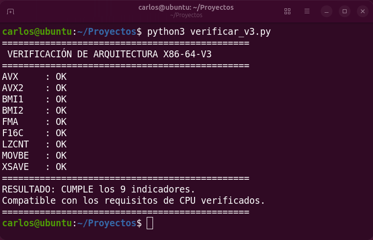

# Script en Python para comprobar si el PC es compatible con X86-64-V3

Simplemente se debe descargar el código en Python, dirigirse a la ubicación de la descarga y el script verificará si el PC cumple con los requisitos para utilizar por ejemplo la imagen ISO de Ubuntu 26.10 optimizado para microarquitectura X86-64-V3 o amd64v3

# Paso a paso

La explicación completa la podrás ver en el siguiente video de Youtube:
https://youtu.be/
